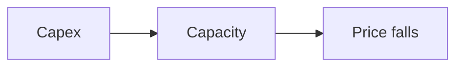

# Publications — how to write and publish articles

Articles are **MDX files** in this folder (`src/content/publications/`). MDX is
Markdown plus React components, so one file can hold prose, images, tables, code,
equations, and interactive charts.

## The 30-second version

1. **Create the article:** add `<slug>.mdx` in this folder.
   The file name is the URL: `powering-the-compute-boom.mdx` → `/publications/powering-the-compute-boom`.
2. **Register it:** add an entry with the same `slug` to `publicationEntries` in
   `src/data/publications.ts` (see **The registry entry** below).
3. **Add images:** drop files in `public/publications/` and reference them as
   `/publications/<file>`, e.g. `/publications/educational-services-structure.svg`.
4. **Add a PDF, spreadsheet, or other file:** drop it in `public/publications/files/`
   and link it, or use `<Pdf>` / `<Download>` (see below). There's no upload form:
   files go in the repo, the same way images do.
5. **If the article recommends a stock,** register the pick in
   `src/data/publication-picks.ts` (see **Articles with a stock pick**).
6. **Run** `npm run dev` and open the article URL. The archive row links to the
   article **automatically**; there's no flag to flip.

The archive row links to the on-site article only when the entry is
`status: "published"` and the `.mdx` file has a body (a file with only `import`
lines counts as empty). Otherwise the row links to `href` if one is set, or
renders as plain text. Team bio pages link to the article the same way.

## The registry entry

```ts
{
  slug: "powering-the-compute-boom",   // same as the .mdx file name
  status: "published",                 // or "draft"
  type: "Research Report",
  title: "Powering the compute boom",
  authors: ["A. Thirumalai"],
  desk: "Energy",
  date: "2026-11",                     // YYYY-MM
  abstract: "One or two sentences on the argument.",
},
```

| Field | What it does |
| ----- | ------------ |
| `slug` | The URL and the `.mdx` file name. Lowercase words joined by hyphens. |
| `status` | `"draft"` hides the piece everywhere: archive, homepage, bio pages, article route, and portfolio research links. The file stays on disk. |
| `type` | `Research Report`, `Investment Memo`, `Technical Report`, `Presentation`, or `Blog`. Drives the archive filter chips. |
| `title` | The page's only H1, and the archive row title. |
| `authors` | Bylines. A member's bio page lists every piece whose `authors` include their `byline` in `src/data/members.ts`. |
| `desk` | `Energy`, `AI`, `Technology`, `Macro`, `Financials`, `EM`, `Strategy`, `Fixed Income`, or `Venture`. The article page suggests up to three other pieces from the same desk. |
| `date` | `YYYY-MM`. The archive sorts newest first; entries in the same month keep their order in the file. Shown as "Nov 2026" in the archive and "November 2026" on the article. |
| `abstract` | Optional. Shown under the title on the article page and used as the search-engine description. |
| `href` | Optional. An external report, or a file such as `/publications/files/<file>.pdf`. Used only when there's no on-site article; opens in a new tab. Use `/publications/download/<file>.pdf` when the row should save the file instead of showing it. |
| `featured` | Optional. Shows the piece in the large block at the top of `/publications`. Keep exactly one; if several are set, the newest published one wins. |
| `coverTitle`, `number`, `format` | Featured only. `coverTitle` is the text on the navy cover (defaults to `title`), `number` is the small label in the cover's corner, and `format` replaces "Web article" next to the buttons. |

### The article header is automatic

The title, type and desk eyebrow, date, reading time, authors, and abstract come
from the registry entry. **Don't repeat them** in the `.mdx`. Start the file with
any imports, then the lede paragraph.

## All five types work the same way

Every type renders through the same article page, so every type supports images,
charts, equations, tables, code, PDFs, video, posts, downloadable files, and stock
picks. Tips per type are near the end of this file.

## Images

- Folder: `public/publications/` (served at `/publications/…`).
- Markdown: ``
- Any web format works: `.svg` (crisp diagrams), `.png`, `.jpg`.
- Keep files under ~500 KB; prefer SVG for charts and diagrams.
- Images render full-width with a thin border, and readers can click one to open
  it in a zoomable viewer (see **Expanding figures**).
- Alt text describes what the image shows ("Two-panel exhibit: correlation heatmap
  of five publishers and their quarterly volatility"), not a label like "chart"
  or "image1". It also becomes the viewer's title.

## Files readers can download

Put the file in `public/publications/files/`. The site path is
`/publications/files/<file>`. Use lowercase names made of letters, numbers, dots,
hyphens, and underscores, starting with a letter or number, such as
`october-model.xlsx`. You can group files in a folder per article:
`public/publications/files/educational-services/model.xlsx`.

Accepted files: PDF, Excel (`.xlsx`, `.xls`), CSV, TSV, ODS, Word (`.docx`, `.doc`),
PowerPoint (`.pptx`, `.ppt`), plain text (`.txt`), JSON, zip, and video
(`.mp4`, `.webm`, `.mov`).

A normal Markdown link to one of these files downloads it (it doesn't open a new tab):

```md
[Download the model](/publications/files/october-model.xlsx)
```

`<Pdf>`, `<Video>`, `<Tweet>`, `<Download>`, and `<Mermaid>` work in every article
with no import. For a PDF you want people to read on the page, use `<Pdf>`: it
shows the pages with Open PDF and Download buttons. On screens 600px wide or less
the pages are hidden and the buttons remain, because in-page PDF viewers are
unreliable on phones.

```md
<Pdf src="/publications/files/full-note.pdf" title="Full note">
  Filed 12 October 2026.
</Pdf>

<Download href="/publications/files/october-model.xlsx" title="Valuation model">
  Quarterly build. Sources are on the Notes tab.
</Download>

<Download
  files={[
    { href: "/publications/files/october-model.xlsx", title: "Valuation model", description: "Quarterly build." },
    { href: "/publications/files/full-note.pdf", title: "Full note" },
  ]}
/>
```

The title is the name readers see. The file name is what their computer saves.
Each file shows its type and size. If the file is missing, the article says so
instead of offering a broken download; while `npm run dev` is running, that note
includes the path it expected. See `educational-services.mdx` and
`portable-alpha-blackrock.mdx` for working downloads.

## Video

YouTube and Vimeo links play in the article. A video file in
`public/publications/files/` plays with a Download button; mp4 is the reliable
choice. Any other link shows "This video is not available" with a link to open it.

```md
<Video src="https://www.youtube.com/watch?v=VIDEO_ID" title="Desk briefing">
  Recorded 3 October 2026.
</Video>

<Video src="https://vimeo.com/123456789" title="Walkthrough" />

<Video src="/publications/files/briefing.mp4" title="Desk briefing" />
```

A `t=90` or `t=1m30s` on a YouTube link starts at that time. Shorts stay vertical.

## Posts on X

Paste the post's public link. The article embeds it and keeps a "View this post on
X" link in case the embed doesn't load. Private accounts and deleted posts won't
appear. `twitter.com` links work the same way. Example: `intelligence-as-a-utility.mdx`.

```md
<Tweet url="https://x.com/name/status/1234567890" />
```

## Text formatting

### Headings: start at `##`

The article title from `src/data/publications.ts` is the page's only H1, so the
body starts one level down.

| Write | Renders as | Use it for | In "In this article"? |
| ----- | ---------- | ---------- | --------------------- |
| `#` | H2, identical to `##` | Don't use it; write `##` | Yes |
| `## Part 1: Setup` | H2: large serif, navy rule above | Major sections | Yes |
| `### The cost curve` | H3: 26px serif | Sections inside a part | Yes, nested under its H2 |
| `#### A detail` | H4: 20px serif | Minor labels, e.g. a company name | No |

- Leave a space after the hashes (`## Title`, not `##Title`) and a blank line
  before and after every heading.
- Don't skip levels: a `####` goes under a `###`, not straight under a `##`.
- Every heading needs unique text. The text becomes the link anchor
  (`## Part 1: Setup` → `#part-1-setup`), so two headings with the same text break
  contents links.
- Keep headings plain text: no bold, italic, links, or code. The contents box
  strips simple formatting, but anything more can make a contents link miss its section.
- Write headings as short titles in sentence case. Put a full sentence in the
  paragraph underneath instead.
- The "In this article" box appears once there are four or more `#`–`###`
  headings. Headings inside code blocks and `{/* comments */}` don't count.

### Paragraphs and line breaks

- Put a **blank line between paragraphs**. Lines with no blank line between them
  join into one paragraph with no space or punctuation added, which turns into a run-on sentence.
- Put a blank line before and after every list, table, quote, callout, and component.
  A line right after a list with no blank line becomes part of the last bullet.
- Don't force a line break inside a paragraph. If you need one, start a new paragraph.

### Emphasis

| Write | Result | Use it for |
| ----- | ------ | ---------- |
| `**bold**` | **bold** | Key terms and the one phrase a skimmer must see |
| `*italic*` | *italic* | Titles of reports, books, and papers; light stress |
| `***both***` | ***both*** | Rarely |
| `~~strike~~` | ~~strike~~ | Showing a revised figure |
| `` `code` `` | `code` | Tickers, file names, commands, model IDs |
| `==highlight==` | yellow highlighter | The single line a reader must not miss |

Bold one phrase per paragraph at most. When everything is bold, nothing stands out.
Raw `<mark>…</mark>` also gives the highlighter.

### Lists

```md
- Unordered item
- Another item
  - Nested item (indent two spaces, level with the parent's text)

1. Ordered item
2. Next step
   1. Nested numbered item (indent three spaces); renders as a., b., c.
   - Nested bullet under a numbered item
```

- Indent a nested item so it lines up with the text of its parent: two spaces
  under `-`, three under `1.`. Four spaces also works.
- Nested bullets render with an en dash; nested numbers render as a., b., c.,
  then i., ii., iii.
- Use `-` for bullets and `1.` `2.` `3.` for steps or ranked items.
- To add a note to a list item, nest it as an indented bullet. A line like
  `-- note` between items isn't valid and gets glued onto the item above.
- Introduce a list with a sentence ending in a colon ("Here is what happened:").
- Keep items parallel: all full sentences with periods, or all fragments without them.

### Quotes

`> text` renders as a large serif pull-quote with a sandstone bar. Use it only
for words someone else wrote, and credit them on the next line:

```md
> Shale reversed long-standing expectations of U.S. import dependence.

Source: [RBAC, *A Short History of the Shale Revolution*](https://rbac.com/…)
```

Don't use `>` to indent or highlight your own points. Use a normal list, or a
`<Callout>` for a key takeaway.

### Links and sources

- Inline: `[Microsoft Research on inference energy](https://…)`. Make the link text
  say where it goes, not "here" or "this link".
- Links starting with `http://` or `https://` open in a new tab automatically.
  Links to `/publications/files/…` download the file.
- Bare URLs also become links, but they're hard to read. Prefer link text.
- Remove tracking junk and stray characters from pasted URLs (for example a trailing `?`).
- End the article with a `## Sources` section as a bulleted list of links:
  `- [Publisher, *Title*](https://…)`.

### Dividers

`---` on its own line, **with a blank line above it**, draws a horizontal rule.
Without the blank line, `---` turns the line above into a heading. `--` (two dashes)
does nothing and prints as text.

### Symbols and punctuation

- Type real arrows and dashes: `→` for flows and `—` (em dash) for asides.
  `->` and `--` print as literal characters.
- `$` starts math. Write money as `\$5B` or `USD 5B`.
- `<` starts a component. Write `&lt;5ms` or rephrase ("under 5 ms").
- `{` and `}` start a JavaScript expression. Write `\{` and `\}` if you need the characters.

### Notes to yourself (drafting)

Anything you type shows up on the published page, including `!put chart here`
style notes. Use an MDX comment instead. It's kept in the file and hidden on the site:

```md
{/* TODO: chart of natural gas prices 2006–2014, BLS PPI. */}
```

HTML comments (`<!-- -->`) don't work in MDX and will break the build.
Search the file for `TODO` before publishing. Comments are for notes only: they
don't do anything, so a pick written as a comment isn't tracked (see
**Articles with a stock pick**).

## Tables, code, and equations

### Tables (GitHub-style)

```md
| Generator | Firm? | Stance     |
| --------- | ----- | ---------- |
| Nuclear   | Yes   | Overweight |
| Gas       | Yes   | Neutral    |
```

Wide tables scroll horizontally inside their box, so there's no extra work for mobile.

### Code blocks

````md
```python
def shortfall(demand_gw: float, firm_gw: float) -> float:
    return max(0.0, demand_gw * 1.15 - firm_gw)
```
````

Code renders on navy with syntax highlighting for common languages (`python`,
`ts`, `js`, `sql`, `bash`, `json`, `r`, …). An unrecognized language tag renders
as plain code. A `mermaid` tag draws a diagram instead (see **Diagrams**).

### Equations (KaTeX)

- Inline: `$C = D \times (1 + r)^t$`
- Block (fences on their own lines; renders in a bordered box that scrolls if wide):

```md
$$
C = \frac{D \times (1 + r)^t}{1 - m}
$$
```

> ⚠️ A bare `$` starts math mode. Write money as `\$5B` or `USD 5B`.
> Also avoid raw `<` in prose (`<5ms` breaks parsing): write `&lt;5ms` or rephrase.

## Components you import

Charts, callouts, and stat grids need an import at the top of the file:

```md
import { Callout, KeyStats } from "@/components/article";
import { BarChartCard, LineChartCard } from "@/components/charts";
```

### Charts (interactive)

```md
<LineChartCard
  title="Data center demand (GW)"
  caption="Source line goes here."
  xKey="year"
  series={[{ key: "hyperscale", label: "Hyperscale" }]}
  data={[
    { year: "2024", hyperscale: 22 },
    { year: "2025", hyperscale: 28 },
  ]}
/>
```

- `LineChartCard` for trends, `BarChartCard` for comparisons (same props).
- `data`: array of objects; `xKey`: the x-axis field; `series`: one entry per line or bar.
- `series` entries: `{ key }` must match a data field; optional `label` and `color`
  (defaults cycle through the site palette). Values must be numbers; anything
  else plots as 0.
- `height`: optional, in pixels (default 320).
- Readers can hover for values and open **View chart data** for a table of every
  point. An **Expand** button redraws the chart at full height; expanded line
  charts also get zoom and pan tools. There's no download button.
- Bar charts print each value above its bar. Keep to about 8 points per series so
  mobile stays readable; for long daily series, export an SVG and use an image.
- Charts draw in the browser. The page reserves their height so layout doesn't
  jump on load.

### Callouts

```md
<Callout title="House view" tone="thesis">
  Your punchline goes here.
</Callout>
```

Tones set the colour of the top rule: `note` (sandstone, default), `thesis`
(navy), `risk` (rust red). `title` is optional.

### Stat grid

```md
<KeyStats
  items={[
    { label: "Demand growth", value: "2×", note: "By 2030" },
    { label: "Modeled gap", value: "38 GW" },
  ]}
/>
```

Best right after the lede. Two to four stats; `note` is optional.

### One-off components

An exhibit that only one article needs can live in `src/components/` and be
imported like the charts. Example: `breakfast-exhibits.tsx`, used by
`low-net-equity-neutal-ls.mdx`.

## Diagrams (Mermaid)

Use a fenced code block with the `mermaid` language. It draws in the browser in
the site palette:

````md

````

For a caption, use the component instead:

```md
<Mermaid caption="How capex turns into lower prices" chart={`flowchart LR
  A["Capex"] --> B["Capacity"] --> C["Price falls"]`} />
```

If the diagram has a syntax error, the article shows its source as a code block.
Check it at [mermaid.live](https://mermaid.live). Examples: `shalevsai.mdx`,
`turbopuffer.mdx`.

## Footnotes (sidenotes)

Write standard Markdown footnotes. They render as **sidenotes**: in the right margin,
level with the line they annotate, on screens 1200px and wider. On narrower screens
the number is a button that opens the note under the line.

```md
Henry Hub fell to around \$2–\$4/MMBtu.[^bls]

[^bls]: U.S. Bureau of Labor Statistics, [*The effects of shale gas production…*](https://www.bls.gov/…).
```

- Put definitions anywhere (the end of the file is tidiest). They don't print at the bottom.
- Numbers follow the order of first reference. A repeated `[^bls]` shows the number only.
- Keep notes short (one to three sentences). Long notes push later ones down the margin.
- Example: `shalevsai.mdx`.

## Expanding figures

Readers can open every figure in a full-screen viewer:

- **Images** (``): click to open. Scroll or pinch to zoom,
  drag to pan, double-click to zoom in or reset, and use `+` / `−` / `0` / the arrow
  keys. The alt text is the viewer's title; alts without spaces, like `nucorchart`,
  show as "Figure".
- **Mermaid diagrams**: same viewer, titled with the caption (or "Diagram").
- **`LineChartCard` / `BarChartCard`**: an **Expand** button redraws the live chart at
  full height. Line charts get zoom and pan tools for exploring a date range.

## Articles with a stock pick

Some pieces end with a call: a stock we'd buy because of the argument. Each pick
is tracked as a paper trade in the **publication portfolio**
(`/publications/portfolio`). The page records the close on the day the piece was
published and the gain since then, and compares it with the S&P 500 over the
same days. It is separate from the fund's real holdings on `/portfolio`.

### Writing the pick

Put the call in its own section at the end of the article, before `## Sources`:

```md
## Our pick

**CrowdStrike (`CRWD`).** One paragraph on why the argument above leads to this
company: what it sells, why demand grows, and what is already priced in.

**What would change our mind:** one or two specific, checkable events.
```

- Name the company and give its ticker in code formatting, e.g. `` `CRWD` ``, or
  `` `7762.T` `` for a non-US listing.
- Make the article's argument lead to the pick. A ticker added at the end without
  that link isn't a call.
- Say what would prove you wrong, so readers can judge the call later.
- A private company ("Anthropic, when it IPOs") can stay in the text, but it isn't
  tracked until it lists. See below.

### Tracking the pick

Add an entry to `publicationPicks` in `src/data/publication-picks.ts`:

```ts
{
  slug: "crwd",                    // unique id, lowercase
  ticker: "CRWD",                  // Yahoo Finance symbol
  name: "CrowdStrike Holdings",
  exchange: "NASDAQ",
  sector: "Cybersecurity",         // one of HoldingSector in src/data/holdings.ts
  city: "Austin",
  country: "United States",
  publication: "ai-cyber",         // the article's slug in publications.ts
  initiationDate: "2026-10-02",    // the day the piece was published
  shares: 10,                      // hypothetical shares
},
```

| Field | Rule |
| ----- | ---- |
| `ticker` | The symbol as Yahoo Finance writes it. Non-US listings carry a suffix: `.T` Tokyo, `.L` London, `.NS` India NSE, `.DE` Xetra. Search the company on finance.yahoo.com if unsure. |
| `publication` | Must match the `slug` of a **published** entry in `src/data/publications.ts`. Picks from drafts or unknown slugs are hidden. |
| `initiationDate` | The full publication date, `YYYY-MM-DD`. The registry only stores the month, so write the exact day here. On a weekend or holiday the next trading day's close is used. |
| `shares` | Hypothetical. Use **10** unless there's a reason not to. Percent returns don't depend on it, but the dollar P&L and the portfolio total do: totals are weighted by cost, so a $500 stock counts five times as much as a $100 stock. |

One article can make several picks; add one entry per stock with the same
`publication`.

**What happens automatically:**

- The pick gets a row on `/publications/portfolio` with the initiation price, the
  latest price, the gain since initiation, and the S&P 500 return over the same days.
- The performance chart on that page marks the initiation close with a dashed rule
  and a ticker flag, and adds the pick to the picks line from that day. The chart
  starts on `PICKS_CHART_START` in `src/lib/picks-performance.ts` (Aug 1, 2026).
- The article gets a "Publication portfolio" strip at its foot, linking to the tracker.
- `/publications` links to the tracker from the page header.
- Prices come from Yahoo Finance and refresh hourly. If a ticker can't be priced,
  the row shows "Price unavailable" and is left out of the totals. Usually the
  symbol is wrong.

**Keep the record honest:**

- Never change `initiationDate` or `shares` after the fact to improve a result.
  Remove an entry only if it was added by mistake.
- For a company that isn't public yet, add it on its first trading day with that
  day as `initiationDate`, not the article's date.
- There's no "sell". A pick is tracked from initiation until the entry is removed.

Check the result with `npm run dev`. Open `/publications/portfolio` and confirm
the initiation price matches the close on that date. Example: `ai-cyber.mdx`.

## Tips per type

- **Research Report:** lede → `KeyStats` → thesis `Callout` → model (equation +
  chart) → tables → risks `Callout` → "what would change our mind" list.
  See `portable-alpha-blackrock.mdx`.
- **Investment Memo:** thesis callout first, then 3–5 headed sections, one table
  (bull/base/bear), one chart at most. End with risks. See `india-emerging.mdx`.
- **Technical Report:** equations and code blocks carry the weight; keep prose
  tight. See `educational-services.mdx`.
- **Presentation:** one `##` per "slide", one visual (chart, image, or table) per
  section. No example published yet.
- **Blog:** short: `KeyStats` or an image, 2–4 sections, one callout. See
  `the-service-systems.mdx`.
- **Any type with a stock call:** end with `## Our pick`, then register it in
  `src/data/publication-picks.ts`. See `ai-cyber.mdx`.

## Before you publish

- [ ] Author identity confirmed; every `authors` byline matches the member roster.
- [ ] Every section finished; no `TODO` comments left that matter to readers.
- [ ] Numbers replaced with sourced figures. Datasets cited with date and URL.
- [ ] Assumptions are labeled as assumptions, separate from findings.
- [ ] Every chart and table has a source in its caption, and chart data is checked against it.
- [ ] Body headings start at `##`, and each heading's text is unique.
- [ ] Exactly one registry entry has `featured: true`.
- [ ] Every PDF, spreadsheet, and video in the article exists under `public/publications/files/`. A PDF is advertised only if its file exists.
- [ ] Embedded posts and videos load, external links work, and each file can be downloaded.
- [ ] Every stock pick in the article has an entry in `src/data/publication-picks.ts` with the exact publication date, and it prices on `/publications/portfolio`.
- [ ] `status` is `"published"`.
- [ ] `npm run build` passes (it prerenders every article).

## Troubleshooting

| Symptom | Fix |
| ------- | --- |
| Row doesn't link to my article | The file must be `<slug>.mdx` with the exact registry `slug`, the entry must be `status: "published"`, and the file needs a body beyond its imports. Restart `npm run dev`. |
| Article URL shows "not found" | Same checks as above. Drafts have no route. |
| "This file is not available" | Put the file in `public/publications/files/` and match the path. Names use letters, numbers, dots, hyphens, and underscores. |
| Video or post is blank | Confirm the YouTube, Vimeo, or X link is public. The caption link still opens the original. |
| Diagram shows as code | The Mermaid source has a syntax error. Paste it into mermaid.live to find it. |
| MDX build error about `$`, `<`, or `{` | Escape money as `\$`, avoid raw `<` in prose, and escape braces as `\{` `\}` (see **Symbols and punctuation**). |
| Pick shows "Price unavailable" | Check the Yahoo Finance symbol and its exchange suffix in `src/data/publication-picks.ts`. |
| Stale error after editing config | `rm -rf .next` and restart dev. |
| Dev port busy | `npm run dev -- --port 3001` (or stop the other server). |
