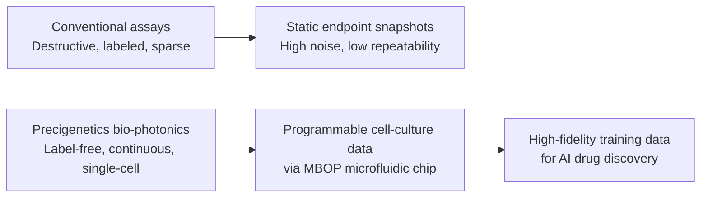

import { Callout } from "@/components/article";

<Callout title="Publication Update" tone="note">
  Revised November 24, 2026.
</Callout>

The biggest bottleneck in AI drug discovery is not compute, and it is not model architecture—it is that conventional biology is measured by destroying it. Foundation models cannot learn cellular dynamics from static end-point "autopsies." **Precigenetics** is building a non-destructive, label-free bio-photonics and microfluidics layer designed to turn living cellular biology into continuous, machine-readable training data.

<Callout title="The thesis" tone="thesis">
  AI in life sciences only compounds when paired with high-fidelity, repeatable biological data. Precigenetics targets the data-generation bottleneck via label-free optical measurement and its modular microfluidic chip (**MBOP**), while clinical proof points like Moderna's individualized mRNA cancer vaccine show where AI already adds measurable value—and where hype outpaces evidence.
</Callout>

## Why biological data is the bottleneck

Biological discovery still relies heavily on destructive, population-averaged assays that perturb or kill the sample at a single moment in time. Converting analog living systems into digital intelligence requires continuous, non-destructive measurement at single-cell resolution.

## Bio-photonics and the MBOP platform

Precigenetics develops a biological foundational layer combining precision optical sensors, signal processing, and adaptive algorithms to translate scattered biological markers into continuous data streams for researchers, biotech firms, and healthcare providers.

Three technical pillars define the platform:

- **Continuous single-cell measurement:** Captures molecular dynamics in living cells at sub-cellular resolution as they happen, rather than reconstructing them post-destruction.
- **Label-free optical interrogation:** Probes native molecular bonds directly, avoiding probe-induced perturbation so the measured cell reflects its true biological state.
- **Single-cell heterogeneity:** Extracts high-dimensional chemical signatures from individual cells rather than population averages, isolating the cellular heterogeneity that drives drug resistance.

On the hardware side, Precigenetics is fabricating **v.1 of MBOP (Modular Biological Observation Platform)**—a microfluidic initiative adapting commoditized semiconductor and microelectronics fabrication methods to integrate disease modeling and cell-culture protocols onto a modular chip. The goal is to turn cell culture and high-content imaging into a repeatable, programmable data source for model training.

<Tweet url="https://x.com/SasaanAShowghi/status/2023564914124877950" />

## Market validation: what Moderna's Phase 3 trial actually proves

Outside of measurement hardware, **Moderna's** positive Phase 3 readout for its individualized mRNA cancer vaccine provides a concrete benchmark for how AI is being deployed in clinical pipelines today. Across more than 1,000 patients with high-risk melanoma whose tumors had been surgically removed, the therapy lengthened recurrence-free survival—marking the first positive Phase 3 result for an individualized mRNA cancer vaccine.

The AI contribution is specific, not magical:

- **Neoantigen selection:** Models predict which tumor-specific antigens, out of hundreds of mutations, are most likely to trigger an immune response.
- **Sequence optimization and manufacturing logistics:** Algorithms assist with mRNA sequence design and coordinate custom patient-specific manufacturing on an approximately six-week turnaround.

**Caveat:** This is not a general "AI cured cancer" moment. The result is in a single indication (resected high-risk melanoma) and validates AI as an optimization layer inside a broader clinical and manufacturing stack, rather than a standalone replacement for wet-lab and clinical execution.

## Financials and scenario framework

Precigenetics has announced a **\$2.3 million letter of intent (LOI)**—not a completed sale. Any allocation of **\$100,000** to licensing remains explicitly speculative. Until the underlying commercial documents are inspected, neither recognized revenue nor licensing revenue should be treated as established.

| Scenario | Core driver | What to verify |
| --- | --- | --- |
| **Bull** | \$2.3M LOI converts to binding commercial contracts; MBOP v.1 fabrication scales repeatable pharma/biotech data partnerships | Signed master service/supply agreements, cash collections, and multi-customer retention |
| **Base** | Paid pilots convert slowly from LOI; MBOP v.1 validates throughput in-house while commercial licensing remains small | Pilot-to-contract conversion rate, gross margin on hardware + data delivery, and burn rate |
| **Bear** | LOI fails to convert to recognized revenue; microfluidic fabrication or optical reproducibility bottlenecks delay commercial rollout | Absence of audited revenue recognition, customer churn, or dilutive bridge financing |

## Risks and diligence gaps

<Callout title="Key risks" tone="risk">
  A letter of intent is not revenue. The primary diligence gap is verifying whether the \$2.3M LOI converts into binding, cash-paying contracts—and whether MBOP v.1 works reliably outside the lab.
</Callout>

- **Unverified revenue:** Neither the \$2.3 million LOI nor the speculative \$100,000 licensing figure represents established, recognized revenue without inspecting the underlying agreements.
- **Hardware and fabrication execution:** Translating semiconductor-style microfluidics into consistent biological cell-culture chips carries yield, contamination, and reproducibility risk at MBOP v.1 scale.
- **Bio-AI hype vs. clinical reality:** As the Moderna melanoma caveat illustrates, AI tools accelerate targeted steps (like antigen selection or imaging throughput) rather than eliminating biological validation timelines.

## Sources

- [Sasaan Showghi on X, *MBOP v.1 announcement*](https://x.com/SasaanAShowghi/status/2023564914124877950)
