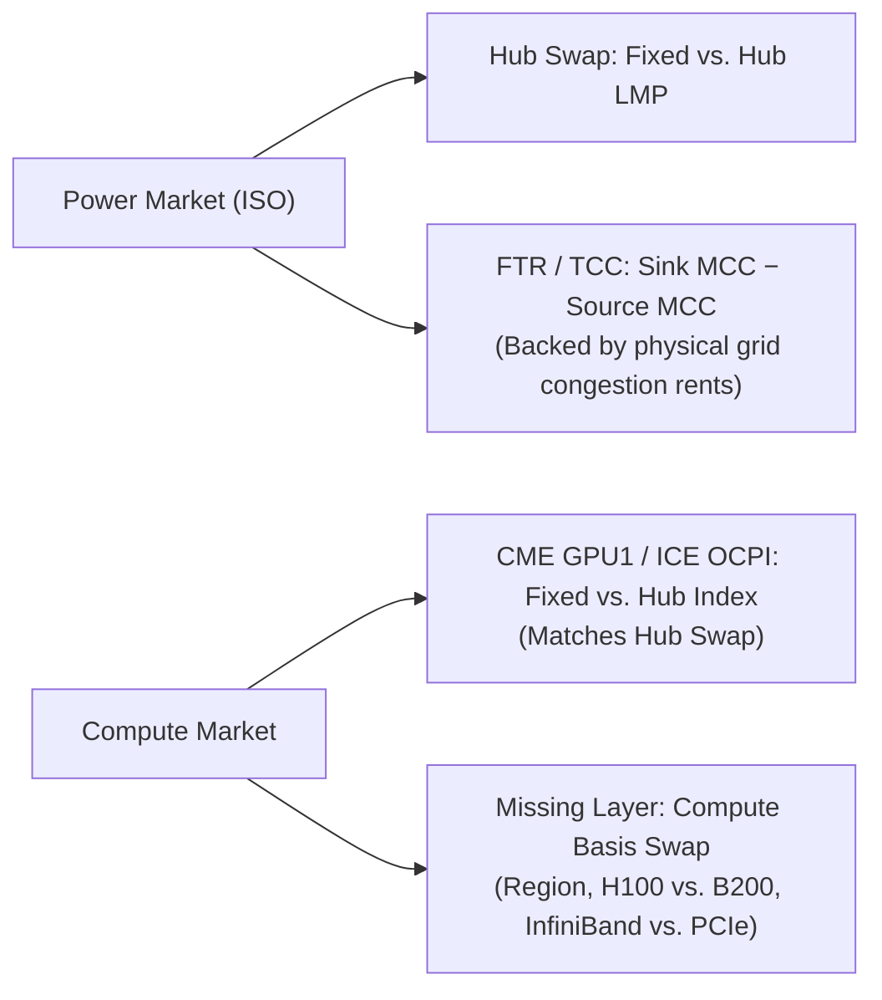

import { Callout, KeyStats } from "@/components/article";

<Callout title="Publication Update" tone="note">
  Revised November 24, 2026. Expands the original outline into a formal quantitative comparison of CME/ICE compute futures and ISO Financial Transmission Rights (FTRs).
</Callout>

With the launch of cash-settled GPU rental futures on **CME Group** (Silicon Data `GPU1` and `GPU2`) and **ICE** (Ornn Compute Price Index, `OCPI`), alongside energy-normalized venues such as **NATIVX**, AI compute is formalizing into a tradeable commodity market. Because data centers are massive, non-storable electricity loads, it is tempting to treat compute derivatives as cousins of power-market **Financial Transmission Rights (FTRs)** or **Congestion Revenue Rights (CRRs)**.

Structurally, they are not. An FTR is a **nodal locational spread** funded by physical ISO congestion rents; a compute future is a **single-hub index swap**. More importantly, electricity accounts for only **3% to 5%** of an H100's hourly rental price—meaning compute futures are overwhelmingly a bet on **silicon scarcity and hardware depreciation**, not megawatt-hours.

<KeyStats
  items={[
    { label: "Power draw at meter", value: "1.5–1.7 kW", note: "Per H100 SXM GPU (10.2 kW HGX node × 1.2–1.3 PUE)" },
    { label: "Power share of rental", value: "~3%–5%", note: "$0.09–$0.10/hr at $60/MWh vs. ~$2.00–$3.03/hr spot" },
    { label: "CME contract size", value: "730 GPU-hrs", note: "1 GPU running 24/7 for an average month (GPU1/GPU2)" },
    { label: "Primary price driver", value: "Capex & scarcity", note: "Depreciation & utilization dominate energy costs" },
  ]}
/>

<Callout title="The thesis" tone="thesis">
  Compute futures replicate a **hub-level power swap**, not an FTR. Because electricity is only ~3%–5% of the GPU-hour rate, energy-normalized indices misclassify the underlying risk. Compute operators face severe unhedged **basis risk** (across regions, chip generations, and interconnect topologies) and must pair compute futures with power-market FTRs to hedge the full **compute spark spread**.
</Callout>

## Payoff replication: hub swap vs. nodal spread

In wholesale electricity markets (PJM, NYISO, ERCOT, CAISO), an FTR—known as a Transmission Congestion Contract (TCC) in NYISO or a CRR in ERCOT/CAISO—is a pure **locational spread** between two electrical buses (a source $a$ and a sink $b$). Its settlement payoff over quantity $Q$ (in MWh) is:

$$
\Pi_{\text{FTR}} = Q \cdot \left(\text{MCC}_b - \text{MCC}_a\right) - P_{\text{auction}}
$$

where $\text{MCC}_i$ is the marginal congestion component of the Locational Marginal Price ($\text{LMP}_i = \text{MEC} + \text{MCC}_i + \text{MLC}_i$) at node $i$, and $P_{\text{auction}}$ is the clearing price paid in the ISO auction.[^ftr] Crucially, FTR payouts are backed by **physical congestion rents** collected by the Independent System Operator when transmission lines bind.

By contrast, a listed compute future—such as CME's `GPU1` (730 GPU-hours per contract, settled against the monthly arithmetic average of the daily Silicon Data H100 Rental Index, `SDH100RT`) or ICE's `OCPI` contracts—is a **cash-settled single-index swap**:[^cme]

$$
\Pi_{\text{Compute}} = Q_{\text{GPU}} \cdot \left(\bar{I}_T - F_0\right), \qquad \bar{I}_T = \frac{1}{N} \sum_{t=1}^{N} I_t
$$

where $I_t$ is the daily benchmark spot rate (\$/GPU-hour) and $F_0$ is the futures entry price. There is no second node and no physical grid clearinghouse. In power-market terms, `GPU1` is a **PJM Western Hub swap**, not an FTR.



## The compute spark spread and the energy-share myth

The physical link between compute and power runs through the data-center meter. A standard 8-GPU **NVIDIA H100 SXM** HGX server draws roughly **10.2 kW** at peak system load (~1.275 kW per GPU including host CPUs and NVSwitch fabric).[^hgx] Inside a modern facility operating at a Power Usage Effectiveness (PUE) of **1.20 to 1.30**, total draw at the utility meter is **1.53 to 1.66 kW per GPU** (~1.5–1.7 kW).

An operator's hourly gross margin—the **compute spark spread**—is therefore:

$$
S_t = R_t^{\text{local}} - \left(\text{kW}_{\text{meter}} \times \frac{\text{LMP}_t^{\text{node}}}{1000}\right) - c_{\text{cap}} - c_{\text{opex}}
$$

where $R_t^{\text{local}}$ is realized rental revenue (\$/GPU-hr), $\text{LMP}_t^{\text{node}}$ is the nodal electricity price (\$/MWh), $c_{\text{cap}}$ is amortized hardware capital recovery, and $c_{\text{opex}}$ is colocation, networking, and maintenance.

Plugging in current market figures exposes why energy-normalized framing (such as NATIVX's `COIL` index, which standardizes compute around delivered kWh blocks) misstates the risk:[^nativx]

- At **\$60/MWh** wholesale power, 1.6 kW at the meter costs **\$0.096 per GPU-hour**.
- Against a **\$2.00/hr** spot/reserved rental—or **\$3.03/hr** on the late-2026 `OCPI-H100` daily settle—electricity is just **3.2% to 4.8%** of the price.[^ocpi]

### Illustrative cost decomposition and sensitivity

Assuming an H100 SXM system cost of ~\$35,000 per GPU (including host/fabric allocation) depreciated over 3 years at 75% average utilization (~6,570 billable hours/year, or \$1.78/GPU-hr capital recovery):

| Cost Component | Base Case (\$/GPU-hr) | Share of \$2.50 Rental | Sensitivity Driver |
| -------------- | --------------------: | ----------------------: | ------------------ |
| Capital recovery ($c_{\text{cap}}$) | \$1.78 | 71.2% | 3-yr vs. 5-yr life ($\$1.07$–$\$1.78$) |
| Colocation, networking & ops ($c_{\text{opex}}$) | \$0.35 | 14.0% | Bandwidth, cooling, staffing |
| Metered electricity (LMP = \$60/MWh) | \$0.10 | 4.0% | \$30–\$120/MWh (**\$0.05–\$0.19**) |
| Scarcity rent / margin | \$0.27 | 10.8% | Utilization & chip-cycle demand |

Doubling wholesale power prices from **\$60/MWh to \$120/MWh** adds less than **\$0.10/hr** to unit cost. Extending economic depreciation from **3 years to 5 years** cuts unit cost by **\$0.71/hr**—seven times larger than a 100% power spike. Compute futures are therefore a **hardware depreciation and utilization derivative**, not an energy proxy.

## Basis risk: compute's unhedged "congestion"

While power is a small share of unit cost, **compute still exhibits severe basis risk** that a single hub index (`GPU1` or `OCPI`) cannot hedge:

1. **Locational basis:** Capacity in low-latency, power-constrained hubs (e.g., Northern Virginia / PJM Dominion) clears at a different price than remote capacity in West Texas or Johor, driven by network latency, data sovereignty, and grid-connection queues.
2. **Silicon-generation basis:** Rapid transitions from `H100` to `H200` and `B200` create cross-generation spread volatility as frontier training migrates while inference remains on older silicon.
3. **Topology basis:** An 8-GPU InfiniBand-connected training cluster commands a structural premium over standalone PCIe inference nodes.

In principle, exchanges or OTC desks could list an FTR-style **compute basis swap** settling on cross-generation or cross-region spreads:

$$
\Pi_{\text{Basis}} = Q_{\text{GPU}} \cdot \left[\left(I_T^{\text{B200}} - k \cdot I_T^{\text{H100}}\right) - B_0\right]
$$

where $k$ is a performance-equivalence ratio (e.g., FLOPs or tokens/sec). Unlike power FTRs, however, there is no physical grid operator collecting congestion rents to fund the payout. Any compute basis swap must be **zero-sum bilaterally cleared**, meaning liquidity will concentrate in the benchmark hub contract (`GPU1` / `GPU2`) while regional and topology spreads remain unhedged residual risk.

## Placing a trade: hedging, basis variance, and auction bias

### 1. Minimum-variance hedge for a neocloud operator

Consider a neocloud operator with fixed lease and power commitments selling local capacity at $R_t^{\text{local}}$ and hedging with `GPU1` futures ($I_t$). Its minimum-variance hedge ratio $h^*$ and residual unhedged variance are:

$$
h^* = \frac{\text{Cov}(\Delta R^{\text{local}}, \Delta I)}{\text{Var}(\Delta I)}, \qquad \text{Var}_{\text{residual}} = \left(1 - \rho^2\right) \text{Var}(\Delta R^{\text{local}})
$$

Because $R_t^{\text{local}}$ reflects local topology (InfiniBand vs. PCIe) and contract duration (on-demand vs. 12-month reserved), $\rho < 1$ leaves substantial basis risk. Simultaneously, the operator can hedge its nodal power cost ($\text{LMP}_t^{\text{node}}$) by pairing a **hub power swap** with an **ISO FTR** from the trading hub to its data-center bus—the exact point where compute hedging and power-market FTRs meet.

### 2. Testing for hedging-pressure bias (the Leslie framework)

In electricity markets, **Gordon Leslie (2021)** examined NYISO TCC (FTR) auctions and showed that systematic differences between auction clearing prices and realized congestion payouts were not driven by generator market power, but rather reflected **compensation to specialized financial traders** providing liquidity and risk-bearing capacity.[^leslie]

As compute futures mature, the exact same empirical test applies to the forward curve:

$$
\alpha = \mathbb{E}\left[\bar{I}_T - F_0\right]
$$

If capital-intensive neoclouds systematically sell forward (`GPU1` / `OCPI`) to satisfy project-finance lenders while natural long buyers (AI labs) prefer flexible spot or custom SLAs, futures should trade in **structural backwardation** ($\bar{I}_T > F_0$, $\alpha > 0$), transferring a risk premium to financial liquidity providers—mirroring the liquidity premium documented in NYISO TCCs.

```python
# Empirical test specification for compute futures risk premium & hedge ratio
# Run once sufficient monthly settlement history (N >= 12) accumulates:
#   excess_return = realized_monthly_avg_index - futures_entry_price
#   t_stat(excess_return) -> tests H0: alpha == 0 (no hedging-pressure bias)
#   h_star = cov(d_local_rate, d_index) / var(d_index)
#   residual_risk_share = 1 - corr(d_local_rate, d_index) ** 2
```

<Callout title="Key risks" tone="risk">
  Nascent compute futures (`GPU1`, `OCPI`) face thin open interest and wide bid-ask spreads. Index methodology risk—how neocloud spot deals are sampled versus hyperscaler private discounts—can widen basis risk for hedgers. Rapid architectural shifts (e.g., custom ASICs or faster-than-modeled GPU obsolescence) can break historical cross-generation hedge ratios $k$.
</Callout>

## Conclusion

Compute futures are a major step toward financing AI infrastructure like a mature commodity, but they are **hub swaps, not FTRs**. Because electricity is under 5% of an H100's hourly rental rate, compute derivatives price **silicon scarcity and depreciation**, not power. Operators who want to lock in the full compute spark spread must hedge two separate markets: **compute futures** for GPU revenue, and **hub swaps plus ISO FTRs** for nodal electricity delivery.

## Sources

- [CME Group / Silicon Data, *H100 & B200 GPU Rental Index Futures (`GPU1` / `GPU2`)*](https://www.silicondata.com/)
- [Intercontinental Exchange (ICE) & Ornn, *Ornn Compute Price Index (`OCPI`) Futures*](https://www.ornn.com/)
- [NATIVX, *COIL / NxCI Energy-Normalized Compute Index*](https://www.nativx.net/)
- [Gordon W. Leslie (2021), *Who benefits from ratepayer-funded auctions of transmission congestion contracts? Evidence from New York*, Energy Economics, 93, 105025](https://www.sciencedirect.com/science/article/abs/pii/S0140988320303650)

[^ftr]: In nodal ISO markets, $\text{LMP}_i = \text{MEC} + \text{MCC}_i + \text{MLC}_i$ (energy, congestion, and marginal loss components). Standard obligation FTRs settle strictly on the congestion differential $\text{MCC}_b - \text{MCC}_a$.
[^cme]: CME's Silicon Data H100 Rental Index Futures (`GPU1`) specify 730 GPU-hours per contract ($365 \times 24 / 12$), cash-settled against the monthly average of the daily `SDH100RT` benchmark.
[^hgx]: NVIDIA HGX H100 8-GPU systems carry a 700W TDP per SXM GPU (5.6 kW GPU-only) and ~10.2 kW peak system power; at 1.20–1.30 PUE, facility meter draw is ~1.5–1.7 kW per GPU.
[^nativx]: NATIVX (`NX Flow`) uses the COIL / NxCI framework to normalize compute around delivered IT energy (kWh blocks per Network Compute Unit) rather than chip-specific rate cards.
[^ocpi]: Late-2026 `OCPI-H100` daily settles hovered around \$3.03/GPU-hr (30-day range ~\$2.78–\$3.53), while spot/reserved H100 instances commonly span \$1.54–\$3.25/GPU-hr.
[^leslie]: Leslie, G. W. (2021), *Energy Economics* 93, 105025, finding that NYISO TCC auction profitability accrues primarily to financial traders supplying liquidity and information rather than generators exercising market power.
