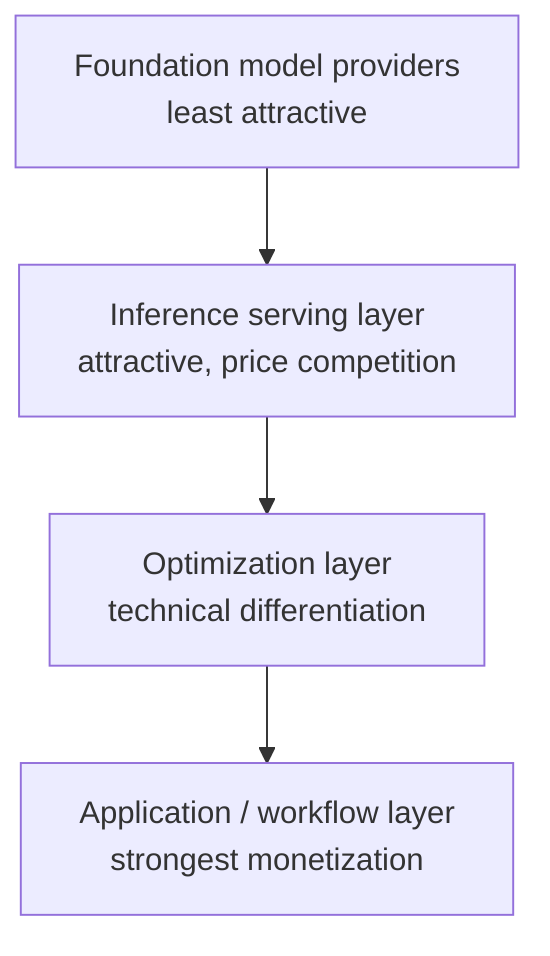

import { Callout } from "@/components/article";

The best businesses here will not simply resell inference. They will own a repeatable optimization loop: understand workload → select or fine-tune model → optimize runtime → evaluate correctness → reduce cost/latency → integrate into production.

## What is strong

- Open weights alone are hard to monetize sustainably because model availability commoditizes quickly.
- Meanwhile, inference is where actual enterprise spending happens because customers pay when the model is used in workflows.
    - Token pricing and usage-based pricing are now central to enterprise AI cost management, and growing agentic workloads can make token consumption harder to predict.
- Cost-of-correct-output
    - Better metric than raw cost per token.
- Enterprises care whether the total system produces accurate, compliant, low-latency output at an acceptable unit cost.
- Customization
    - Large platforms are pushing enterprises toward multi-model and tailored-model strategies rather than full dependence on a few frontier models. This means that enterprise value may accrue around customization and deployment rather than generic foundation access.

## Weak Points

1. The biggest hole is that “inference-optimized services” may also become commoditized.
    - vLLM, SGLang, TensorRT-LLM, semantic routing, KV-cache optimization, quantization, and model serving frameworks are increasingly open or widely available.
    - If everyone can use the same optimization stack, the question becomes: where is the durable gross margin?
    - Caching = can materially improve throughput and cost, especially when prompts repeat or shares long prefixes. Research on LMCache claims large throughput gains from sharing KV caches across inference engines and queries. But if caching becomes a default feature in open-source inference stacks, it may be a feature rather than a company.
2. Underplays hyperscaler bundling risk.
    1. AWS Bedrock, Azure AI Foundry, Google Vertex AI, Databricks, Snowflake, and enterprise SaaS vendors can bundle model hosting, governance, data access, and billing into existing enterprise contracts.
    2. A standalone inference provider needs to prove it has superior performance, lower cost, better model breadth, better developer experience, or a vertical workflow wedge.
3. Pricing = Which pricing model produces predictable gross margin as workloads shift from simple chat to long-context, agentic, multimodal, and tool-using systems.

### Hard Hitting Questions

- What is the actual wedge? Is the company winning because it is cheaper per token, faster per token, more reliable, more secure, easier to deploy, better at fine-tuning, or better at vertical outcomes?
- What aspect is proprietary? If the company’s differentiation is vLLM plus GPUs plus a nice API, that is not enough. If the differentiation is workload-specific routing data, evals, fine-tuning recipes, deployment integrations, or proprietary usage telemetry, that is more interesting.
- Who is the buyer? A developer may care about latency and model availability. A CIO may care about governance and cost control. A business owner may care about outcome accuracy. These are different GTM motions.
- What workloads have enough repeatability for caching and optimization to matter? Customer support, coding agents, document processing, search/RAG, voice agents, healthcare admin, legal review, and financial research may each have different inference economics.
- Does open source expand the market or destroy pricing? Open-weight models lower barriers to adoption, but they also make it easier for customers to self-host or switch vendors.
- What happens when frontier APIs cut prices? If OpenAI, Anthropic, Google, or xAI reduce prices aggressively, does the open-source inference service still win on cost, control, latency, or customization?
- What is the gross margin at scale? The IC will care less about revenue growth and more about GPU utilization, reserved capacity risk, customer concentration, inference mix, and whether optimizations expand margin.

### Market map skeleton

1. Foundation model providers
    1. Closed frontier labs and open-weight model creators. This is the least attractive area unless the company has extraordinary scale, distribution, or research advantage.
2. Inference serving layer
    1. Together AI, Fireworks, Groq, Cerebras, Replicate-like platforms, cloud model endpoints, and internal enterprise deployments. This is attractive but at risk of price competition.
3. Optimization layer
    1. Routing, batching, caching, quantization, speculative decoding, GPU scheduling, prefill/decode separation, latency management, and evaluation-aware model selection.
    2. This is likely where technical differentiation exists, but it may collapse into open-source infrastructure unless it is packaged into enterprise workflows.
4. Application/workflow layer
    1. Vertical agents, support automation, coding, document review, claims processing, sales ops, compliance, and finance workflows.
    2. This may be the strongest monetization layer because customers pay for outcomes, not infrastructure.

### Next Steps

- Workload economics
    - Customer support agents, code generation, and document extraction
- Model cost per successful task across closed frontier APIs, open source hosted inference, and self-hosted inference.

Ask: how much of the cost reduction comes from generic open-source improvements versus proprietary workload learning? If the answer is mostly generic, the company is a services/API margin trade, not a venture-scale platform.

- **Token economics:** At what workload reuse rate does self-hosting beat API pricing given realistic GPU utilization?
- **Customization value:** How much does task-specific fine-tuning reduce required model size or token usage for a target accuracy?
- **Inference orchestration:** What routing policies (small model vs large model) minimize cost-of-pass for mixed workloads?
- **Pricing design:** How to structure cache-aware pricing so customers aren’t penalized for repeated context?
- **Risk transfer:** Which compliance and verification features command the largest enterprise willingness to pay?

### Bottom line

This is a good thesis seed, but the investable question is not whether monetization shifts from weights to inference. It is:

> ==Which companies can turn open-source model abundance into proprietary, defensible, high-margin production systems before hyperscalers and open-source frameworks absorb the value?==

But an MD would immediately ask:

> Which inference services, for which workloads, with what moat, and why won’t hyperscalers or open-source tooling compress the margin?

## The Cost of Fine Tuning Models

finetuning will always look better in every way if you ignore real inference costs

for the same sized model, you'll typically need to pay 2x-10x compared to per-token rates if you want to bring your own weights and pay per GPU/hr

this often ignored premium along with the rate of lab releases and price drops makes it actually much harder to make a case for fine-tuned models (esp if >4B param)
