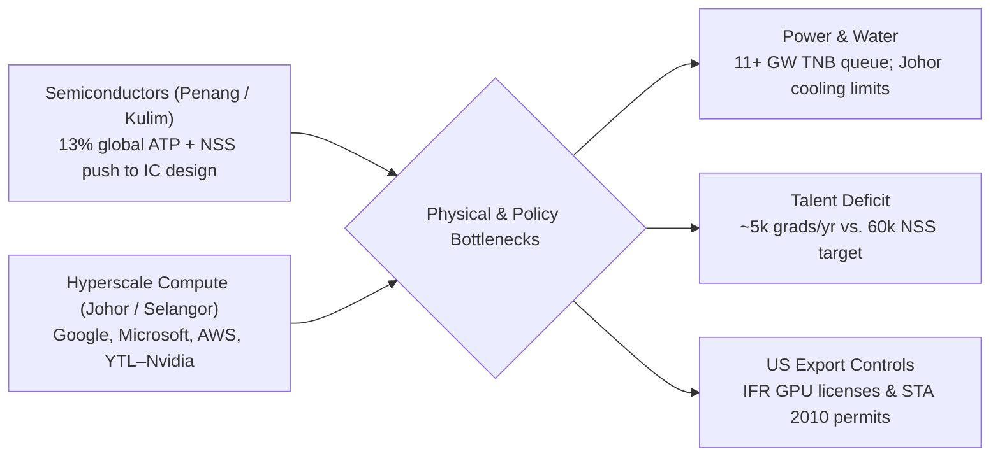

import { Callout, KeyStats } from "@/components/article";

<Callout title="Publication Update" tone="note">
  Revised November 24, 2026 to incorporate full-year MIDA investment data, Johor power and water grid constraints, and U.S. AI chip export-control enforcement.
</Callout>

While U.S.–China semiconductor headlines focus on leading-edge lithography in Taiwan and export bans in Beijing, Malaysia has quietly become a dual-engine node in the global AI supply chain. It already commands roughly **13% of global back-end semiconductor assembly, testing, and packaging (ATP)**, and it is now absorbing a multi-gigawatt wave of hyperscale data-center capacity spilling over from land- and power-constrained Singapore.

For emerging-market and infrastructure investors, the question is not whether capital is flowing into Malaysia—it clearly is. The question is whether Malaysia can convert low-margin chip assembly and power-hungry server farms into durable domestic value before **power, water, engineering talent, and U.S. export controls** cap the upside.

<KeyStats
  items={[
    { label: "Global back-end ATP share", value: "13%", note: "Assembly, testing, and packaging (NSS)" },
    { label: "Approved investments", value: "RM 426.7B", note: "+11% YoY across sectors; 244,902 jobs (MIDA)" },
    { label: "NSS engineer target", value: "60,000", note: "By 2030; 13,679 trained in initial rollout" },
    { label: "TNB grid applications", value: "11+ GW", note: "Data centers could reach ~30% of load by 2035" },
  ]}
/>

<Callout title="The thesis" tone="thesis">
  Malaysia is capturing a real share of global semiconductor diversification and Southeast Asian AI compute, but the investment opportunity is narrower than headline FDI figures suggest. The most durable returns sit in scarce physical bottlenecks—grid connections, industrial land, and water-efficient infrastructure—while pure-play chip assembly and GPU hosting face rising U.S. licensing scrutiny and an acute engineering shortage.
</Callout>

## From assembly hub to dual-engine AI node

The clearest signal of Malaysia's shift is not rhetoric—it is the velocity of approved capital and hiring. According to the Malaysian Investment Development Authority (MIDA), total approved investments across services, manufacturing, and primary sectors reached a record **RM 426.7 billion** (up 11% year-on-year), carrying commitments for **244,902 new jobs**, anchored by Electrical and Electronics (E&E) and digital infrastructure.[^mida] Within semiconductors specifically, H1 2025 alone saw **RM 54.9 billion** in approved investments creating **more than 25,000 jobs**—a 2.3× faster job-creation pace than full-year 2023 (11,000+ jobs on RM 69.4 billion).

Under the **National Semiconductor Strategy (NSS)**, launched in May 2024 with at least **RM 25 billion** in fiscal support, Kuala Lumpur is pushing to move Penang and Kulim beyond back-end ATP into **IC design, advanced packaging, and wafer fabrication**, supported by partnerships such as the ARM–Malaysia IC design training program.[^nss]

In parallel, **Johor and Selangor** have emerged as Southeast Asia's primary hyperscale data-center release valve. Constrained by Singapore's land and power limits, global cloud providers have committed billions across the causeway: **Google** (\$2 billion), **Microsoft** (\$2.2 billion), **AWS**, and sovereign AI deployments such as **YTL Power's** partnership with **Nvidia** in Johor.[^dc]

## The geopolitical tightrope: "China Plus One" meets U.S. export controls

Malaysia's pitch as a neutral, English-speaking, non-aligned manufacturing base has helped attract major expansions from Western and European incumbents like **Intel** and **Infineon**. That positioning still holds for mature-node fabrication and back-end packaging.

On **leading-edge AI compute**, however, neutrality has collided with Washington's export-control perimeter. U.S. Department of Commerce Interim Final Rules (IFR) tightened licensing requirements for advanced AI GPUs shipped to Malaysia and restricted overseas data centers from providing remote compute access to Chinese-linked entities.[^sta] Following transshipment investigations into regional cloud tenants, Malaysia's Ministry of Investment, Trade and Industry (MITI) activated Section 12 "catch-all" permits under the **Strategic Trade Act (STA) 2010** and adopted a strict *"comply or leave"* posture on U.S.-origin AI hardware.

Kuala Lumpur is threading a narrow needle: enforcing U.S. Know-Your-Customer (KYC) and licensing rules on American silicon while preserving broader trade and industrial ties with China. For investors, this means **sovereign and U.S.-parented cloud deployments** sit on far firmer regulatory footing than third-party GPU-rental intermediaries.

## The three constraints that decide returns

Headline investment announcements are commitments, not realized cash flows. Three physical and human constraints will determine how much of Malaysia's approved pipeline translates into durable earnings:

### 1. The engineering talent deficit

An earlier bull case framed Malaysia's tech labor shortage purely as a wage tailwind for domestic consumption. That misses the execution risk. The NSS targets **60,000 high-skilled engineers by 2030**, with **13,679** trained and deployed in the initial rollout.[^nss] Yet Malaysia's universities graduate roughly **5,000 engineers per year** against industry demand estimated at **50,000+**, with 77% of Asia-Pacific employers reporting difficulty filling technical roles.

While **~5% annual wage inflation** (on sector base salaries already roughly double the national average) supports local purchasing power, a chronic talent bottleneck **caps how quickly firms can scale high-margin IC design and R&D**, forcing reliance on foreign talent or slowing project ramp-ups.

### 2. Power and water grid strain

Hyperscale AI clusters are far denser than traditional enterprise colocation. National utility **Tenaga Nasional Berhad (TNB)** has fielded **more than 11 GW** in data-center electricity connection applications; projections suggest data centers could consume **up to 30% of Peninsular Malaysia's electricity by 2035**.[^dc] In Johor, evaporative cooling demand is already straining municipal water supplies, prompting stricter permitting and a push toward closed-loop, water-efficient cooling designs. Scarcity here transfers pricing power to **grid-connected land owners, utilities, and industrial-park developers**.

### 3. Realization lag and tariff exposure

MIDA figures track *approved* investments, which typically deploy over three to five years. Any escalation in U.S. semiconductor tariffs or tighter rules on transshipment could delay or redirect capital before shovels hit the ground.

<Callout title="Key risks" tone="risk">
  Approved FDI may fail to convert into realized capex on schedule. Grid-connection bottlenecks and Johor water limits can stall data-center commissioning. U.S. export-control enforcement or new semiconductor tariffs could curtail third-party AI hosting margins, while Malaysia's engineering shortage risks capping its move up the value chain into IC design.
</Callout>

## What to watch

To separate durable infrastructure winners from headline hype over the next 12–24 months, track four concrete signposts:

- **TNB connection conversion:** How much of the 11+ GW application queue converts into energized megawatts versus speculative land banking.
- **Johor permitting standards:** Whether state authorities restrict water-intensive cooling approvals, favoring established industrial-park operators with dedicated utilities.
- **Approved vs. realized FDI:** Quarterly MIDA realization rates in E&E and digital infrastructure, rather than gross approval headlines.
- **U.S. Commerce licensing:** Whether U.S.-headquartered hyperscalers maintain smooth GPU import exemptions while non-U.S. regional GPU clouds face tighter KYC audits.

## Sources

- [Malaysian Investment Development Authority (MIDA), *Investment Performance Reports & E&E Sector Overview*](https://www.mida.gov.my/)
- [Ministry of Investment, Trade and Industry (MITI), *National Semiconductor Strategy (NSS) & Strategic Trade Act 2010*](https://www.miti.gov.my/)
- [Google, *Google Announces \$2 Billion Investment in Malaysia* (Elmina Business Park, Selangor)](https://blog.google/around-the-globe/google-asia/google-malaysia-2-billion-investment/)

[^mida]: MIDA reported a record RM 426.7B in total approved investments (+11% YoY) supporting 244,902 committed jobs, with electronic components accounting for roughly 59% of E&E approvals.
[^nss]: Launched in May 2024 with at least RM 25B in fiscal support, the NSS targets 60,000 engineers by 2030; MITI parliamentary disclosures cited 13,679 trained and deployed in the initial rollout.
[^dc]: Industry and utility disclosures place TNB data-center grid applications above 11 GW, with projections reaching ~30% of Peninsular Malaysia's electricity demand by 2035 alongside heightened Johor water scrutiny.
[^sta]: MITI invoked Section 12 "catch-all" provisions under Malaysia's Strategic Trade Act (STA) 2010 requiring Strategic Trade Permits for high-performance U.S.-origin AI chips amid heightened U.S. Commerce IFR enforcement.
