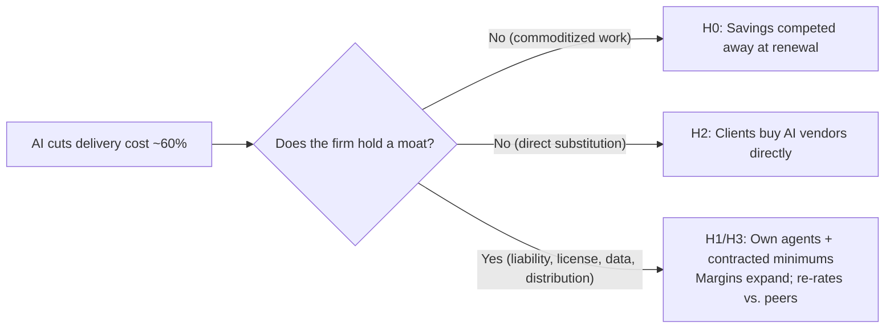

import { Callout, KeyStats } from "@/components/article";

<Callout title="Publication Update" tone="note">
  Revised November 24, 2026 to incorporate 2026 sector drawdowns, AI-native margin benchmarks, and the wave of AI-led services take-privates (Amex GBT, The Baldwin Group, and ADT).
</Callout>

Services firms have always grown by hiring. To add 10% to revenue, a firm adds roughly 10% to headcount, so margins stay capped and operating leverage never arrives. AI breaks this link. The public market's reaction has been to sell the whole sector on the view that the savings will flow to clients and to AI vendors, not to the firms. For most services firms, that view is probably right. This piece argues that it is wrong for a minority—and that telling the two groups apart is where the opportunity lies, as private-market buyers committing nearly \$30 billion to AI-led services take-privates in 2026 have already begun to wager.

<KeyStats
  items={[
    { label: "Gross margin after the shift", value: "65%", note: "From 30%, after a 20% price cut and a 60% cost cut" },
    { label: "Break-even price cut", value: "42%", note: "Gross profit per unit falls only beyond this" },
    { label: "Volume needed", value: "+25%", note: "To hold revenue flat after a 20% price cut" },
    { label: "2026 AI take-privates", value: "$29.3B", note: "Amex GBT ($6.3B), Baldwin ($7.7B), ADT ($15.3B)" },
  ]}
/>

<Callout title="The thesis" tone="thesis">
  The market is pricing services firms as AI losers. Most of them are. The opportunity is the minority with a moat—liability, regulation, proprietary data, or distribution—that stops competitors from passing the savings on to clients. Without a moat, every firm gets the same cost cut and the margin goes to the customer.
</Callout>

## The market currently disagrees

Through 2025 and into 2026, public-market investors marked services stocks down for AI risk across the board: IT services, business process outsourcing (BPO), research and information firms, and Indian IT. India's Nifty IT index suffered a roughly 19% plunge over a handful of sessions early in 2026—its sharpest drop since 2008—with major IT services benchmarks experiencing 25% to 35% peak-to-trough drawdowns as investors priced in structural "AI deflation" to labor-arbitrage revenue.[^nifty] Software multiples also compressed as investors questioned whether autonomous agents would shrink seat-based products.

That makes the case for select services winners a contrarian call. The market treats services as a single block that AI will shrink. The argument here is narrower: the sector will split, and public markets have not yet separated the firms that will keep the gains from the firms that will give them away.

## Why services revenue has tracked headcount

The traditional services firm is a pyramid: a few senior people selling and reviewing work, and many junior people delivering it. Revenue is hours multiplied by rates. Utilization has a ceiling, wages rise every year, and growth means recruiting, training, and managing more people. Revenue per employee barely moves, so margins barely move.

## What AI changes, and what it does not

AI agents, automated workflows, and specialized models now do a growing share of the delivery work: drafting, reconciling, coding, triaging, and resolving. A firm can handle much more volume without a matching increase in staff.

The marginal cost of an extra unit of work falls sharply, but it does not approach zero. Several costs remain:

- **Model usage**, which scales with volume.
- **Human review**, which most clients and regulators will still require.
- **Liability**: errors, insurance, and rework.
- **Integration and maintenance** of the workflows themselves.

AI-native software companies illustrate this floor. Whereas traditional B2B SaaS has historically treated 80% to 85%+ gross margins as table stakes, venture benchmarks from Andreessen Horowitz and Bessemer Venture Partners show AI-native applications typically operating at 50% to 60% gross margins—and often lower during hyper-growth—because every prompt and agentic loop triggers variable inference COGS.[^margins] The cost shift in services is large, but it has a floor, and any financial model that ignores the new AI cost line will overstate the gain.

## The pricing problem

Once work gets faster, billable hours become a trap. Clients will not keep paying for hours the firm no longer spends. The firm has to change how it charges, and the transition carries a real risk of a revenue dip.

### The arithmetic of a price cut

Take a service line with a 30% gross margin. Suppose AI lets the firm cut its delivery cost by 60%, and competition or negotiation forces a 20% price cut.

| Per unit of work | Before | After |
| ---------------- | -----: | ----: |
| Price | 100 | 80 |
| Delivery cost | 70 | 28 |
| Gross profit | 30 | 52 |
| Gross margin | 30% | 65% |

Gross profit per unit rises by about 73%. More useful than any single scenario is the break-even point: gross profit per unit only falls below its old level if the price drops by more than 42%.

$$
P - 28 = 30 \implies P = 58 \quad (\text{a } 42\% \text{ price cut})
$$

There is a condition hidden in this. For total revenue to stay flat after a 20% price cut, volume has to rise by at least 25% (since 1 ÷ 0.8 = 1.25). The argument that AI expands the addressable market, by making services affordable to mid-market clients who could not buy them before, depends on demand growing at least that much. That is an assumption, not a finding.

### A worked example, with the full cost breakdown

The following firm is **hypothetical**. It starts with revenue of 100, delivery costs of 70, overhead of 18, and operating profit of 12. Revenue falls 15% in every scenario as clients push prices down.

| Scenario | Revenue | Delivery | New AI costs | Overhead | Profit | Change |
| -------- | ------: | -------: | -----------: | -------: | -----: | -----: |
| Starting point | 100 | 70 | 0 | 18 | 12 | — |
| Delivery −50%, AI costs ignored | 85 | 35 | 0 | 18 | 32 | +167% |
| Delivery −28%, AI costs ignored | 85 | 50.4 | 0 | 18 | 16.6 | +38% |
| Delivery −50%, AI costs included | 85 | 35 | 15 | 18 | 17 | +42% |

The gap between +167% and roughly +40% comes down to one line: what the new AI stack costs, or how much of the delivery saving is real. That line is where diligence should focus. A management team that presents the second row without the fourth has left something out.

### Pricing models that can hold margin

Four approaches, each with its own risk:

1. **Outcome-based pricing.** Charge for the result—for example, per resolved ticket, per filed return, or per completed hire. Intercom's Fin AI Agent, priced per resolution, is a working example.[^intercom] The risk is that revenue rises and falls with volume.
2. **Base fee plus usage.** A committed platform or retainer fee, plus a variable charge. This gives recurring visibility and keeps some upside.
3. **New pricing for new business.** Legacy clients stay on hourly contracts until renewal. All new clients and AI-delivered service lines go on outcome or usage pricing.
4. **Price below the old rate, deliberately.** As the arithmetic above shows, a firm can cut prices substantially and still earn more gross profit, as long as it keeps the cut well short of 42%.

## Will outcome pricing earn a software multiple?

It is tempting to argue that AI-enabled services firms will be re-rated toward software multiples. That claim runs directly into the pricing problem. Investors pay software multiples for **contracted, recurring revenue**. Pure per-outcome pricing is transactional: it rises and falls with volume.

Transaction pricing is also not new. BPO firms and healthcare revenue-cycle companies have long charged per claim, per transaction, or as a share of collections. That model never earned software multiples before AI, so any bull case has to explain why it would now.

There is a precedent to address as well. Indian IT firms have promised growth without matching headcount since about 2010, through in-house software platforms and automation. It did not get them re-rated. Platform revenue stayed small, and clients captured most of the productivity gains at each contract renewal.

Three things could make this cycle different, and all three have to show up in reported numbers:

- **Gross margin is structurally higher.** The cost reduction is far larger than earlier automation waves delivered.
- **Revenue is contracted.** Committed minimums and platform fees, with usage on top, make revenue more predictable than pure per-transaction pricing.
- **The firm owns the software.** It runs its own agents rather than reselling someone else's, so the margin stays in-house.

The realistic base case is a re-rating **relative to services peers**, not to software. Firms that prove durable margins and retention should trade at a premium to a de-rated sector. Matching software multiples would require contracted revenue that most of these firms do not yet have.

## Who keeps the savings

A 60% cost cut is real value. The question is who captures it. There are four competing explanations:

| Hypothesis | Prediction | Status |
| ---------- | ---------- | ------ |
| H0: competitors pass the savings on to clients | Revenue per contract falls and margins stay flat as contracts renew | Probably the current market view; not ruled out |
| H1: services firms keep the gains | Gross margin and revenue per person rise together, with no rise in client losses | Possible, but only for firms with a moat |
| H2: AI vendors keep the gains | Clients buy agents directly and skip the services firm | A real threat for commoditized work |
| H3: winners and losers split | The sector is marked down while firms with data, liability, or regulatory moats are valued higher | The best-supported framing |

H3 is the framing this piece adopts. The moat is the centre of the thesis, not one item on a checklist. The moats that matter:

- **Liability.** The firm signs the audit, files the return, or certifies the claim, and the client is paying for someone to stand behind the result.
- **Regulation and licensing.** Only licensed firms can do the work, which limits both new competitors and direct purchase from AI vendors.
- **Proprietary data.** Years of domain-specific outcomes make the firm's agents better than a generic model.
- **Distribution and trust.** Embedded relationships make switching slow and costly.

### Real-world tests: Klarna and the AI take-private wave

Two sets of real-world evidence illustrate both the limits of naive automation and the conviction behind moat-backed transformation.

First, **quality ceilings are real**. In February 2024, Klarna announced that its OpenAI-powered assistant was handling two-thirds of customer-service chats—2.3 million conversations in its first month, doing the work of roughly 700 full-time agents.[^klarna] By mid-2025, CEO Sebastian Siemiatkowski publicly acknowledged that the push to pure automation had "gone too far," citing lower service quality on complex issues, and moved to bring human agents back into a hybrid model. Cost savings that erode service quality reverse.

Second, **private capital is already underwriting H3 at scale**. In 2026, a new class of AI-native holding companies backed by top venture firms began executing multi-billion-dollar take-privates of legacy services businesses to rebuild them around proprietary agentic stacks:

- **Long Lake Management** (backed by General Catalyst and Alpha Wave) completed a **\$6.3 billion** take-private of **American Express Global Business Travel (Amex GBT)** in September 2026, integrating its *Nexus AI* platform into global corporate travel and expense workflows.[^longlake]
- **Sequence Holdings** (backed by Sequoia Capital and DFO Management) agreed in September 2026 to take independent insurance broker **The Baldwin Group** (`BWIN`) private for **\$7.7 billion**—an 88% undisturbed premium—to rebuild its brokerage operations around Sequence's *Atlas* AI platform.[^sequence]
- **Thrive Holdings** (spun out of Thrive Capital and partnered with OpenAI, with Apollo financing) agreed in October 2026 to acquire home-security leader **ADT** for roughly **\$15.3 billion**, embedding forward-deployed AI engineers into alarm monitoring and field operations.[^thrive]

These buyers are not paying 48% to 88% premiums for generic BPOs; they are buying entrenched distribution, regulatory standing, and domain data, then pairing them with owned AI platforms. As J.P. Morgan Asset Management has noted on private equity in the age of AI, operational execution—not financial engineering—will drive widening dispersion between winners and losers.[^jpm]

## What to look for

### Green flags

- A clear moat of the kinds listed above. Without one, nothing else on this list lasts.
- Management guiding toward outcome or usage pricing **with committed minimums**.
- Rising **gross profit per delivery worker**, counting contractors and net of AI costs.
- Client retention that holds up after the switch to AI delivery.
- Gross margin and revenue per contract that hold at renewal.

Revenue per employee is the obvious metric, but it is easily distorted by offshoring, contractors, pass-through revenue, and acquisitions. Gross profit per delivery worker, including contractors and after AI costs, is harder to flatter.

### Red flags

- AI used only to cut internal costs while hourly pricing stays unchanged. Clients will demand the savings at renewal.
- Rising client losses as legacy contracts expire.
- Heavy spending on generic AI tools that are not built into the firm's workflows.
- Profit projections that leave out a line for model, review, and liability costs.

### Sectors to watch

| Sector | Likely moat | Main risk |
| ------ | ----------- | --------- |
| Healthcare revenue-cycle management | Payer rules data, compliance | Clients or software vendors bring the work in-house |
| Tax, audit, and accounting | Signature liability, licensing | Price compression in the mid-market |
| Insurance claims and brokerage | Regulation, claims and placement data | Carriers or platforms automate directly |
| Legal services | Liability, privilege | Clients buy legal AI tools directly (H2) |
| IT services and generic BPO | Weak: mostly distribution | Savings competed away (H0) and AI vendors (H2) |

This table is a framework for screening, not a ranked list of positions.

## What would change this view

The deciding evidence is about two years of contract renewal data. For each firm, track gross margin and revenue per contract, and compare firms that changed their pricing with firms that did not.

- **Support for H1 or H3:** margins and multiples rise specifically at firms that switched to outcome or usage pricing, while client losses stay flat.
- **Support for H0:** clients demand a share of the savings at renewal, and revenue per contract falls while margins stay where they were.
- **Support for H2:** clients' spending moves from services contracts to AI vendors directly.

<Callout title="Key risks" tone="risk">
  The volume needed to offset price cuts may not appear. New AI costs may be larger than modelled. Competitors without a moat may cut prices hard enough to drag down everyone else. And the market's bearish view of the sector may simply be correct.
</Callout>

## Conclusion

The market is right that AI will shrink most of the services sector. It is wrong to price every firm the same way. Firms that own a moat, own their agents, and win contracted pricing can keep the savings that their competitors will be forced to hand over. That difference is not yet in public-market prices—even as private buyers have begun paying up to capture it.

## Sources

- [SumProduct, *The First AI Take-Private: What a \$6.3bn Deal Tells Modellers* (Long Lake / Amex GBT)](https://sumproduct.com/blog/ai-blog-the-first-ai-take-private-what-a-6-3bn-deal-tells-modellers/)
- [Dealroom, *The AI Take-Private Playbook: How Long Lake Convinced a 111-Year-Old Travel Giant That Robots Make Better Employees*](https://app.dealroom.co/news/note/the-ai-take-private-playbook-how-long-lake-convinced-a-111-year-old-travel-giant-that-robots-make-better-employees)
- [Dealroom, *Sequoia Backs Sequence AI Holdco Behind \$7.7B Baldwin Take-Private*](https://dealroom.co/news/172124-sequoia-backs-sequence-ai-holdco-behind-7-7b-baldwin-take-private/)
- [Latham & Watkins, *Latham Advises Sequence AI Holdings in Take-Private Acquisition* (Sept 2026)](https://www.lw.com/en/news/2026/09/latham-advises-sequence-ai-holdings-in-take-private-acquisition)
- [Thrive Holdings, *Company & Strategy* (ADT acquisition, Oct 2026)](https://www.thriveholdings.com/)
- [J.P. Morgan Asset Management, *Private Equity Selection in the Age of AI*](https://am.jpmorgan.com/wr/en/asset-management/institutional/insights/portfolio-insights/alternatives/in-the-age-of-ai/)
- [Intercom, *Pricing* (Fin AI Agent, priced per resolution)](https://www.intercom.com/pricing)
- [Klarna, *Klarna AI assistant handles two-thirds of customer service chats in its first month* (Feb 2024)](https://www.klarna.com/international/press/klarna-ai-assistant-handles-two-thirds-of-customer-service-chats-in-its-first-month/)

[^nifty]: Indian IT and BPO indices saw sharp AI-deflation drawdowns in early 2026, with the Nifty IT index dropping ~19% over several sessions and major IT services benchmarks falling 25%–35% from peaks amid fears of autonomous coding and workflow compression.
[^margins]: Venture benchmarks from Andreessen Horowitz and Bessemer Venture Partners place mature AI-native application gross margins around 50%–60% (versus 80%–85%+ for traditional B2B SaaS) due to ongoing model inference COGS.
[^intercom]: Intercom prices its Fin AI Agent on a per-resolution basis ([intercom.com/pricing](https://www.intercom.com/pricing)).
[^klarna]: Klarna's Feb 2024 release reported 2.3M chats handled (equivalent to ~700 FTEs); in May 2025, CEO Sebastian Siemiatkowski told Bloomberg the company had "gone too far" on pure automation and reopened human customer-service hiring.
[^longlake]: Long Lake Management (backed by General Catalyst and Alpha Wave) announced the \$6.3B take-private of Amex GBT at \$9.50/share in May 2026 and closed it in September 2026.
[^sequence]: Sequence Holdings (backed by Sequoia Capital and DFO Management) agreed to acquire The Baldwin Group (`BWIN`) for \$32.50/share (~\$7.7B EV, an 88% undisturbed premium) in September 2026.
[^thrive]: Thrive Holdings agreed in October 2026 to acquire ADT for ~\$15.3B including debt, with financing from Apollo Global Management.
[^jpm]: J.P. Morgan Asset Management, [*Private Equity Selection in the Age of AI*](https://am.jpmorgan.com/wr/en/asset-management/institutional/insights/portfolio-insights/alternatives/in-the-age-of-ai/).
