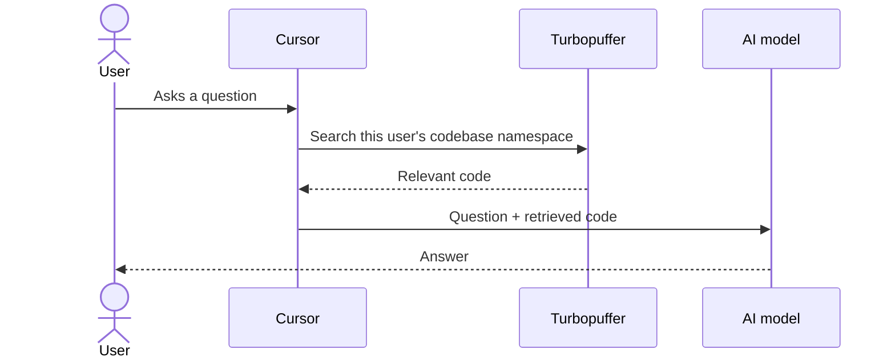

import { Callout, KeyStats } from "@/components/article";
import { BarChartCard, LineChartCard } from "@/components/charts";

**[Turbopuffer](https://turbopuffer.com/)** is a search database that helps applications find relevant information across large collections of documents. It supports both **keyword search** and **semantic search**—searching for similar meaning using numerical representations called *embeddings*. [turbopuffer.com](https://turbopuffer.com/docs?utm_source=chatgpt.com)

The distinction is that **Turbopuffer retrieves relevant material; the LLM interprets it**. You could also combine semantic search with keyword search—for example, to make sure an exact course code or tool name is considered. Turbopuffer calls this *hybrid search*. [turbopuffer.com](https://turbopuffer.com/docs/hybrid?utm_source=chatgpt.com)

One feature of its design is that it stores data in cloud object storage and uses caching to serve searches. That can make it attractive at large scale, though the company notes that uncached queries and writes can be slower. [turbopuffer.com](https://turbopuffer.com/docs?utm_source=chatgpt.com)

**Turbopuffer is a business-to-business infrastructure company that helps software applications search their data.** It sells a managed search database to companies building products such as AI coding assistants, workplace search, and research tools.

Its business thesis is straightforward: as AI applications search more documents and code, the cost and speed of retrieving relevant information matter. Turbopuffer aims to make that retrieval cheaper by building its search engine around cloud object storage, while using faster storage and memory as caches. [turbopuffer.com](https://turbopuffer.com/docs?utm_source=chatgpt.com)

The company is private. Its co-founders are **Simon Hørup Eskildsen**, CEO, and **Justine Li**; both previously worked on infrastructure at Shopify. [turbopuffer.com](https://turbopuffer.com/about?utm_source=chatgpt.com)

## What problem does it solve?

An AI model may be good at answering questions, but it still needs access to the relevant information. Consider asking Cursor:

> “Where in this codebase is user authentication handled?”

The application must search a potentially large codebase, find useful files or snippets, and supply them to the model. That retrieval step has to happen quickly and at a reasonable cost, potentially across millions of separate customer codebases.

Turbopuffer provides the search layer for that process. Its database supports:

- **Full-text search:** Finds documents using words or identifiers, such as a function name.
- **Vector search:** Finds material with similar meaning using numerical representations called embeddings.
- **Hybrid search:** Combines both approaches.
- **Metadata filtering:** Narrows results using fields such as a customer, project, or document category.

Its product is useful beyond generative AI: businesses can also use it for conventional search, recommendations, and other retrieval applications. [turbopuffer.com](https://turbopuffer.com/docs?utm_source=chatgpt.com)

## Where it sits in the AI value chain

For an application like Cursor, the workflow looks roughly like this:

**User asks a question → Cursor searches the codebase using Turbopuffer → relevant code is retrieved → an AI model uses that code to answer.**

Turbopuffer is an infrastructure provider behind the scenes. It does not need to own the user-facing application or the AI model to earn revenue from that workflow. Cursor says it uses Turbopuffer for code retrieval and creates a separate search namespace for each user and codebase. [marketplace.turbopuffer.com](https://marketplace.turbopuffer.com/customers/cursor?utm_source=chatgpt.com)

That makes Turbopuffer somewhat analogous to a database or cloud provider: a customer incorporates its service into a product, and the end user may never see the Turbopuffer brand.

## Who are its customers?

Its customers are software companies and other organizations that need search capabilities inside their products or workflows.

| Customer | Example use | Why the search layer matters |
|---|---|---|
| **Cursor** | Finding relevant code for its AI coding features | It must search many separate codebases efficiently. |
| **Notion** | Search, Q&A, and research across workspace data | It needs to retrieve relevant information from a large volume of documents. |
| **Linear** | Searching issues | Users need to find relevant tickets and project information. |
| **Enterprise and AI companies** | Search across internal documents, customer records, or other data | AI tools need relevant context to answer questions or perform tasks. |

Turbopuffer also lists companies including Anthropic, Atlassian, Ramp, and Cognition as customers, although their precise workloads should not be assumed to be identical. [marketplace.turbopuffer.com](https://marketplace.turbopuffer.com/customers/cursor?utm_source=chatgpt.com)

## How does Turbopuffer make money?

It sells **managed search infrastructure with usage-based pricing**. The major drivers of a customer’s bill include:

1. **Storage:** How much searchable data the customer keeps.
2. **Writes:** How much data is added or updated.
3. **Queries:** How much data the customer searches.
4. **Plan and deployment requirements:** Larger customers can pay for enterprise features and support.

For sustained high-volume workloads, Turbopuffer also offers *namespace pinning*, which charges for reserved capacity in GB-hours instead of the standard per-query approach for that namespace. Pricing depends on the workload, plan, and configuration. [Sacra](https://sacra.com/c/turbopuffer/?utm_source=chatgpt.com)

A simplified example:

> Cursor grows from 1 million to 2 million active users. If that growth leads it to index more code and run more searches, its Turbopuffer usage—and potentially its bill—can grow even if Turbopuffer has not signed another customer.

That is the appeal of a **usage-based model**: Turbopuffer can expand revenue as its customers’ products grow. The tradeoff is that spending can also decline if customers optimize workloads, build their own search systems, switch providers, or see usage fall.

The company’s website currently shows a **$16 monthly minimum for its Launch plan**, while the cited pricing page describes enterprise plans and additional deployment and support options. [turbopuffer.com](https://turbopuffer.com/?utm_source=chatgpt.com)

## Why might customers choose it?

### 1. Lower search costs

The core architectural idea is to keep durable data in relatively inexpensive **object storage**, while caching data on faster SSDs and in memory when it is needed. This can be attractive when a customer has a huge amount of data but only a portion is searched frequently. [turbopuffer.com](https://turbopuffer.com/docs/concepts?utm_source=chatgpt.com)

Turbopuffer’s customer case studies report:

- **Cursor:** A 20× reduction in costs after migrating.
- **Notion:** An 80% cost reduction for the relevant workload; the case study says this helped Notion remove per-user AI charges. [marketplace.turbopuffer.com](https://marketplace.turbopuffer.com/customers/cursor?utm_source=chatgpt.com)

Those are **company-published case studies**, not independent guarantees. A different customer’s savings would depend on its existing system, data, and query patterns.

### 2. Less infrastructure to manage

A customer can use Turbopuffer’s managed service instead of building and operating its own distributed search system. Its case study says Cursor also reduced the operational complexity of managing its codebase indexes. [marketplace.turbopuffer.com](https://marketplace.turbopuffer.com/customers/cursor?utm_source=chatgpt.com)

### 3. Search across many separate customers

Applications like Cursor and Notion serve many users and organizations. Their data may be divided into many isolated *namespaces*, such as individual codebases or workspaces. Turbopuffer’s architecture is designed to handle large numbers of these separate search collections.

### 4. It can change what customers can afford to build

This is perhaps the most interesting economic point. If retrieval is expensive, a product team may limit the amount of data it indexes or restrict how often users can search. If retrieval becomes much cheaper, the customer can make more information searchable or add features that previously did not make economic sense.

Turbopuffer says that after Cursor’s migration, Cursor began creating more vectors per user. That illustrates a possible feedback loop: **lower cost per unit can lead to more usage**, which can benefit both the customer and Turbopuffer. It does not, by itself, tell us how much Turbopuffer earned from that expansion. [turbopuffer.com](https://turbopuffer.com/blog/turbopuffer?__from__=talkingdev\&utm_source=chatgpt.com)

## The cost advantage also has tradeoffs

Object storage is relatively inexpensive, but retrieving data from it can be slower than accessing data already in memory. Turbopuffer uses caching to help manage this.

The company explicitly identifies **higher write latency and occasional slower cold queries**—queries against data that is not already cached or pinned—as tradeoffs in its design. For customers with strict latency requirements, performance under their own workload matters as much as the headline price. [turbopuffer.com](https://turbopuffer.com/docs?utm_source=chatgpt.com)

## How large is the business?

In a public post, CEO Simon Hørup Eskildsen said Turbopuffer crossed a **$100 million annualized revenue run rate in March 2026**, was profitable, and had raised **less than $1 million**. These are company statements; detailed financial statements are not public in the sources reviewed. [106 comments](https://www.linkedin.com/posts/sirupsen_turbopuffer-crossed-100m-run-rate-in-march-activity-7463237416338915328-QQ8A?utm_source=chatgpt.com)

A **$100 million annualized run rate does not mean the company had already collected $100 million over the preceding 12 months**. It is a way of expressing a point-in-time revenue pace as an annual figure. Usage-based revenue can fluctuate, so it also should not automatically be treated as contracted recurring revenue.

Its company page identifies **Lachy Groom and Thrive Capital** as backers. [turbopuffer.com](https://turbopuffer.com/about?utm_source=chatgpt.com)

## Competitive position and investment thesis

From an investor’s perspective, Turbopuffer is a way to think about the **retrieval layer of the AI infrastructure stack**. The strongest version of the thesis would be:

> As companies connect AI applications to more proprietary data, they will need to search that data more often. A provider that makes search cheaper, reliable, and easy to operate can grow alongside its customers’ AI workloads.

Potential strengths include its customer references, architecture suited to infrequently accessed data, and usage-based expansion. But several questions matter before concluding it has a durable advantage:

- **Competition:** Search is a crowded market. Turbopuffer competes with specialist vector databases such as Pinecone and Qdrant, established search systems such as Elastic, database extensions such as PostgreSQL with pgvector, and cloud-provider services. Competitors can also improve their pricing and architecture.
- **Customer concentration:** A few fast-growing AI customers could contribute a large share of revenue. Their names are public, but Turbopuffer has not disclosed the revenue share attributable to each in the sources reviewed.
- **Pricing pressure:** Even if search demand rises, competitors may drive down the price of storage and queries.
- **Cloud dependence:** Turbopuffer relies on underlying cloud infrastructure. Its margin depends in part on what it pays for storage, compute, and related services versus what customers pay it.
- **Changing AI architecture:** Larger model context windows or different retrieval techniques may change how applications search data. They could reduce some searches while enabling other, more complex workflows; the net effect is uncertain.
- **Economics versus technical performance:** The lowest-cost search engine is valuable only if customers accept its search quality, latency, reliability, and operational features.

My interpretation is that Turbopuffer’s opportunity resembles a **toll on a growing activity**, but the toll is not guaranteed: customers pay for a service they can compare, optimize, or potentially replace. The central question is whether Turbopuffer can keep enough of a performance-and-cost advantage to grow revenue even as the price per search falls.
